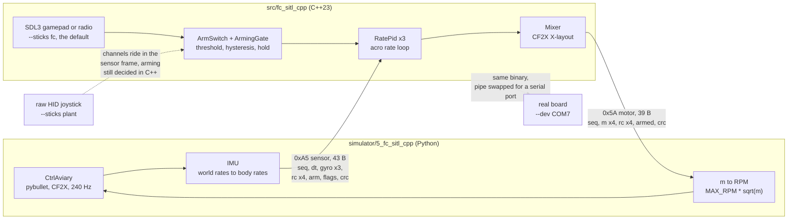

# fc-simulation

A minimum viable quadcopter flight controller in C++23, and a Python simulator
to fly it against before any hardware exists. The firmware sees only gyro
frames arriving on a pipe and a gamepad it reads itself, which is the same
thing it would see wired to a real board.

> **Status: exploratory.** I am building this one rung at a time and the layout
> keeps moving, so do not depend on the folder names or the wire format yet.
> The five simulator steps all work today and are the useful part.

```
plant: CF2X at 240 Hz
controller: bin\clang-cl\fc_sitl_cpp.exe
acro mode - it will NOT self-level. Ctrl+C to quit.

t=  0.0s --- thr=0.00 z=  0.11 m  roll=  +0.0 pitch=  -0.0 deg  m=['0.00','0.00','0.00','0.00']
t=  1.0s ARM thr=0.62 z=  0.33 m  roll=  -0.0 pitch=  +0.0 deg  m=['0.62','0.62','0.62','0.62']
t=  2.0s ARM thr=0.62 z=  3.60 m  roll=  -0.0 pitch=  +0.0 deg  m=['0.62','0.62','0.62','0.62']
```

## What it does

- **Lockstep HIL over a pipe.** Every physics step blocks on the controller's
  reply, so nothing runs in real time and a run reproduces exactly.
- **Binary framing with CRC**, declared once in `src/fc_sitl_cpp/fc_core.hpp` and
  mirrored in Python: 43-byte sensor frame (`0xA5`), 39-byte motor frame
  (`0x5A`), CRC-8 poly `0xD5`, the same polynomial CRSF uses.
- **Flight logic with zero I/O.** `fc_core.hpp` holds the rate PID, the mixer
  and the arming gate and touches no hardware, so it unit-tests on a host and
  should port to a target unchanged.
- **A real plant**, gym-pybullet-drones' `CtrlAviary` flying a Crazyflie 2.X at
  27 g, rather than a physics model I made up.
- **The gamepad belongs to the controller**, not to the simulator, because that
  is where the receiver lives on a real aircraft. `--sticks plant` flips it for
  the case where it has to: a Zephyr `native_sim` build cannot reach a USB
  device at all, so the sticks have to come down the wire instead. The arming
  decision stays in C++ either way.

## Architecture

Two processes. The firmware knows nothing about the simulator, and the
simulator has no control law of its own, so killing either one leaves the other
obviously broken rather than quietly compensating.



Every physics step blocks on the controller's reply. Nothing runs in real time,
so a run reproduces exactly, and a controller that is slow to answer just makes
the sim take longer rather than dropping frames.

The gamepad hangs off the firmware, not the simulator, because that is where
the receiver sits on a real aircraft. The plant never sees a stick position, it
only sees four motor demands coming back.

`--sticks plant` is the exception, and it exists for one reason: a Zephyr
`native_sim` binary has no USB host to speak of, so if the sticks do not arrive
on the wire they do not arrive. The plant then reads the HID device itself and
fills in `rc[4]` and the raw arm channel. It sends the raw channel deliberately,
not an armed flag: the threshold, the hysteresis, the hold and the throttle gate
all stay in `fc::ArmSwitch`, because that is the code that eventually flies.

## Progression

Each step adds exactly one thing. The column that changes is the point of that
step.

| step | plant | controller | link | sticks |
| --- | --- | --- | --- | --- |
| 1 | hand-made `quad.urdf`, forces in newtons | Python PD, same process | none | none |
| 2 | none | none | none | **read the pad** |
| 3 | **CtrlAviary, CF2X, motor RPM** | Python, stabilised | none | **both sticks** |
| 4 | CtrlAviary | Python, acro | **JSON lines over a pipe** | pad, owned by the controller |
| 5 | CtrlAviary | **C++ `fc_sitl_cpp`** | **binary + CRC-8** | pad or radio over SDL3 |
| 6 | CtrlAviary | C++ `fc_sitl_cpp` | **pty, with an emulated baud** | **either side may read it** |

Step 3 is where the interface stops being invented: `CtrlAviary` owns the
mixer, so the controller's job becomes producing four motor demands, which is
what the firmware already produces. Step 4 moves the controller out of the
process. Step 5 replaces it with the real one and nothing about the plant has
to change. Step 6 swaps the pipe for a pseudo-terminal, which is what Zephyr
will hand you, and makes the wire speed visible: at 115200 the round trip is
7.12 ms against a 4.17 ms control period, so it tops out near 140 Hz.

## Requirements

- CMake 3.23 or newer, and a C++23 compiler
- Conan 2 for the C++ dependencies (fmt 12.1.0, CLI11 2.6.2, SDL 3.4.14,
  GoogleTest 1.17.0). `CMakeLists.txt` sets `PKG_MANAGER "conan"`; there is a
  commented line right above it to switch to vcpkg
- CPython 3.11 for the simulator. Everything installs from a wheel, so no MSVC
  toolchain is needed for the Python side
- An Xbox-style gamepad, if you want to fly it rather than watch a script
- Tested on: Windows 11, clang-cl, Xbox 360 controller. Nothing else yet

## Build

```bash
git clone <clone-url>
cd fc-simulation
cmake --preset clang-cl-debug
cmake --build --preset clang-cl-debug
```

The simulator shares one environment at the repo root:

```bash
py -3.11 -m venv .venv
```

```bash
.venv\Scripts\python.exe -m pip install -r requirements.txt
```

```bash
.venv\Scripts\python.exe -m pip install --no-deps --ignore-requires-python -r requirements-gpd.txt
```

Two installs because gym-pybullet-drones is not on PyPI, and the dependencies
it declares pull stable-baselines3 and PyTorch, several GB that nothing here
imports. See [requirements-gpd.txt](requirements-gpd.txt) for the details.

## Usage

The simulator is five steps, each one adding a single thing. Run them in order
the first time, since each answers a question the next one assumes.

| step | what it adds | run |
| --- | --- | --- |
| [1. pybullet check](simulator/1_pybullet_check/README.md) | does 3D work on this machine at all | `.venv\Scripts\python.exe simulator\1_pybullet_check\smoke_test.py` |
| [2. gamepad test](simulator/2_gamepad_test/README.md) | reading the pad, no install needed | `python simulator\2_gamepad_test\gamepad_test.py` |
| [3. ctrlaviary check](simulator/3_ctrlaviary_check/README.md) | the real plant, then flying it stabilised | `.venv\Scripts\python.exe simulator\3_ctrlaviary_check\fly_demo.py` |
| [4. fc sitl py](simulator/4_fc_sitl_py/README.md) | controller split into its own process | `.venv\Scripts\python.exe simulator\4_fc_sitl_py\plant.py` |
| [5. fc sitl cpp](simulator/5_fc_sitl_cpp/README.md) | the real C++ controller in the loop | `.venv\Scripts\python.exe simulator\5_fc_sitl_cpp\plant.py` |
| [6. fc sitl tty](simulator/6_fc_sitl_tty/README.md) | a pty instead of a pipe, and a real baud rate | `python simulator/6_fc_sitl_tty/plant.py` (Linux) |

Step 5 is the one that matters. It launches the binary itself, so that command
is all you need once the firmware is built. Press LB with the throttle down to
arm, press again to disarm, B is a hard disarm.

Either side can own the radio. `--sticks fc` is the default and matches
hardware; `--sticks plant` has this script read the HID device and send the
channels down the wire, which is what a Zephyr build will need:

```bash
.venv\Scripts\python.exe simulator\5_fc_sitl_cpp\plant.py --sticks plant
```

`python simulator/common/radio_hid.py` prints live channel numbers if you need
to find your `--ch-*` values. Those numbers do **not** carry between Windows and
Linux: the two backends enumerate axes differently.

To fly it without a gamepad, the firmware carries canned stick scripts:

```bash
.venv\Scripts\python.exe simulator\5_fc_sitl_cpp\plant.py --no-gui --fc-args=--script=arm-hover
```

## Limitations

- **The C++ controller is acro only.** It is given body rates and nothing else,
  and a rate is all you can close a loop on. Stabilised mode exists only in the
  Python `fly_demo.py` at step 3.
- **The Windows radio reader is unproven.** `common/radio_hid.py` reads
  `/dev/input/jsN` on Linux, which works, and `joyGetPosEx` on Windows, which
  has never been run against an actual radio. `joyGetPosEx` also tops out at six
  axes, so a transmitter reporting eight loses the top two there.
- **The Python gamepad reader at step 2 is Windows only.** It uses XInput
  through ctypes, and only Xbox-style pads show up there at all. Everything else
  runs on both.
- **No tests run.** `test/` has a file in it, but `add_subdirectory(test)` is
  commented out in `CMakeLists.txt`. `fc_core.hpp` is pure logic and would
  unit-test cleanly, I just have not wired it up.
- No CI, so "tested on" above means I ran it on my machine.
- gym-pybullet-drones is pinned to a git commit rather than a release, and it
  declares `>=3.12` while running fine on 3.11, so the install needs
  `--ignore-requires-python`.
- The wire format is not stable yet. Change one side and you change the other.

## Roadmap

Porting `fc_core.hpp` to Zephyr is the next real step. It is already written
with no I/O in it for exactly that reason, so the work should be the platform
layer in `platform.hpp` and the build, not the flight logic.

## License

MIT - see [LICENSE](LICENSE).
